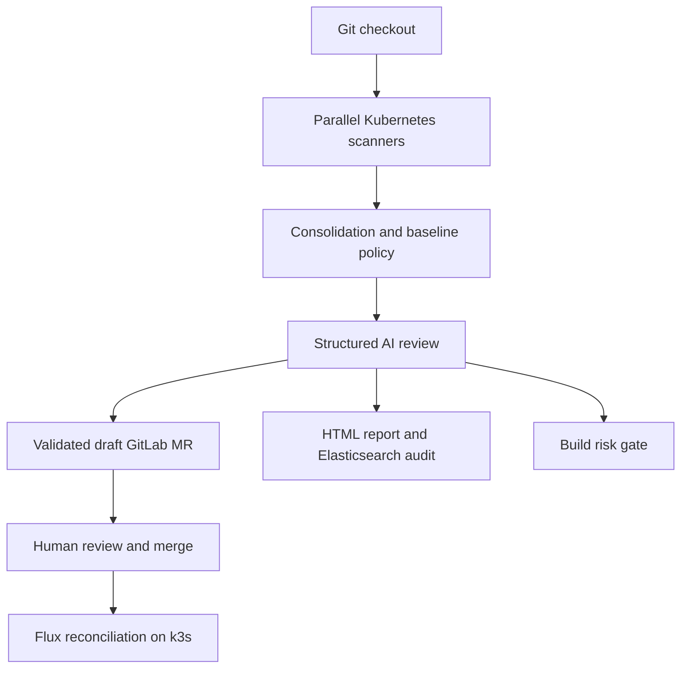

# TALAN — AI-assisted Kubernetes DevSecOps

[](https://github.com/Rayenne10/devsecops-talan/actions/workflows/verify.yml)

A public internship code snapshot refined into a reproducible review workflow: Jenkins runs **kube-linter and kube-score in parallel**, Python consolidates the findings, OpenAI proposes structured explanations and YAML fixes, and GitLab receives **draft merge requests for human review**. A deterministic security policy blocks unsafe builds independently of the AI rating.

## Architecture



The gate is an audit result; it does not itself deploy. Flux is independently configured to watch the reviewed Git branch. Protect that branch with required approvals and successful checks: a failed Jenkins build does **not** stop Flux from reconciling an unprotected branch.

## Try it without credentials

Linux/WSL on x86-64, Python 3.12+, curl and Bash:

```bash
python3 -m venv .venv
source .venv/bin/activate
pip install -r requirements-dev.txt
bash scripts/install-scanners.sh "$HOME/.local/bin"
export PATH="$HOME/.local/bin:$PATH"
pytest -q
bash scripts/demo.sh
```

The demo runs real scanners on two fixtures, writes `analysis.json`, `ai-report.json` and `audit-report.html`, and proves that the deliberately unsafe manifest is blocked. The final PASS means that the **expected blocked gate** was observed. Offline mode makes no OpenAI calls, generates no AI patches and creates no GitLab MR. Scanner best-practice findings in the secure fixture are still available for review; “baseline secure” does not mean every scanner check is satisfied.

## Jenkins and observability lab

```bash
export GRAFANA_ADMIN_PASSWORD='choose-a-local-password'
docker compose -f docker-compose/docker-compose.yaml up --build -d
```

Open Jenkins at http://localhost:8080 and Grafana at http://localhost:3000. Get the Jenkins initial administrator password using `docker compose -f docker-compose/docker-compose.yaml exec jenkins cat /var/jenkins_home/secrets/initialAdminPassword`. Create a Pipeline from SCM using this repo and `Jenkinsfile`. Required plugins are installed in the image. OFFLINE is enabled by default; the unsafe fixture makes the audit build fail intentionally.

The lab creates its own named volumes and network. Ports bind to loopback, Jenkins runs as its normal non-root user, and no Docker socket is mounted. Elasticsearch security is disabled only for this isolated local lab. Prometheus monitors itself; Grafana provisions Prometheus and the Elasticsearch audit datasource. Historical internship infrastructure dashboards/exporters are not included in the original public snapshot. Configure authenticated exporters and TLS before using these components beyond your laptop.

Stop with `docker compose -f docker-compose/docker-compose.yaml down`. Add `--volumes` only if you intend to erase Jenkins configuration and audit history.

## Live AI and GitLab workflow

Store `OPENAI_API_KEY` and `GITLAB_API_TOKEN` as Jenkins secret-text credentials, never in Git. Disable OFFLINE to use the configurable `OPENAI_MODEL` (default `gpt-4o-mini`, matching the original code). The workflow uses strict JSON Schema, a 60-second request timeout, and at most three retries for transient connection/rate-limit errors. Invalid, truncated or refused responses fail the stage.

Set the GitLab project/target branch parameters and enable CREATE_DRAFT_MR only when the GitLab mirror contains the **exact audited `GIT_COMMIT`**. Use a scoped project access token and a protected target branch. The commit API creates a new branch from that SHA, then opens a `Draft:` MR. No auto-merge or cluster write exists in the Python workflow. API calls have timeouts and reject redirects. A failed MR request may leave its proposed branch behind: inspect GitLab and remove it before retrying the same build identifier.

Patch validation allows only scanned paths, preserves resource identities, rejects Secrets/List objects and baseline policy violations, and limits patch size. This is deliberately conservative; new resources require a separate manual change. It does not prove Kubernetes schema compatibility or application correctness. Review images, commands, network access and business behavior, rerun scanners and perform server-side validation before approval. Manifests sent to OpenAI must contain no sensitive configuration, proprietary data or embedded credentials.

## GitOps demo

`gitops/apps` contains only the secure example; **never reconcile the `k8s` fixture directory**. With Flux already installed on your k3s lab:

```bash
kubectl apply -f gitops/flux/source.yaml
kubectl apply -f gitops/flux/reconciliation.yaml
flux get sources git -A
flux get kustomizations -A
kubectl rollout status deployment/secure-demo
```

These examples watch the public GitHub repository. For the internship GitLab workflow, change the GitRepository URL/ref and configure a Flux secret for your protected GitLab mirror. Human approval must precede the watched branch update. The included configs do not install Flux or provision k3s.

## Evidence and interview preparation

See [verification scope](docs/VERIFICATION.md), [interview notes](docs/INTERVIEW.md) and [security boundaries](docs/SECURITY.md). CI runs Python safety tests, dependency auditing, real scanner/offline integration, and builds the Jenkins image. It archives reports for 30 days.

**Historical claims versus public evidence:** the internship description reports 15+ manifests, 23 findings in 31 seconds, Flux/k3s and infrastructure monitoring. The original public repository had **two manifest files**, no benchmark receipts, no Flux configuration and no Prometheus provisioning. Those historical metrics cannot be reproduced or independently established from this snapshot. The new demo configs and tests are portfolio refinements, not retroactive evidence of internship delivery. The original work and Git history remain attributable to their original contributors; no new license is imposed on internship code.
